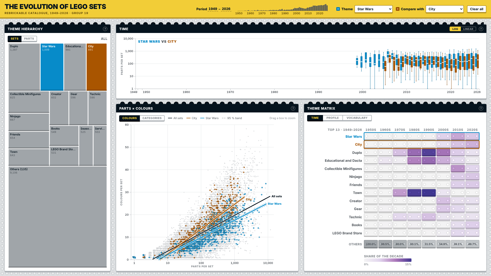
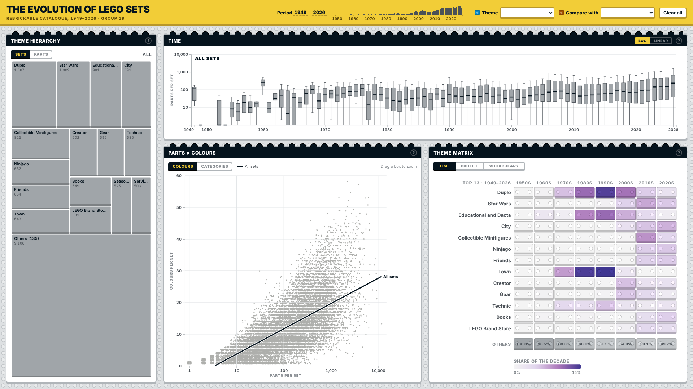

# 🧱 The Evolution of LEGO Sets: an interactive dashboard

> **TL;DR:** An interactive dashboard, built with **D3.js**, that explores about **20,000 LEGO sets** released from 1949 to 2026. Four linked charts show how sets got bigger and more colourful over time, which themes (Star Wars, City, Duplo, ...) dominated each decade, and which pieces make each theme unique. Picking a theme or a time period in one place updates every chart at once. Master's project for *Information Visualization* at Instituto Superior Técnico (2026/27).



*Star Wars (blue) compared with City (orange): their share of the catalogue (left), set sizes per year (top), parts vs. colours (middle) and share of each decade (right).*

---

## What is this, in plain words?

**Data visualization** is about turning a big table into pictures that let people *see* patterns. Here the table is the full LEGO catalogue from [Rebrickable](https://rebrickable.com): every set, its theme, its parts and their colours.

The dashboard answers seven questions:

1. How have the typical **size** (number of parts) and the spread of sets changed over time?
2. Which **themes dominated** each decade? Is the catalogue concentrated in a few themes or spread out?
3. How are parts distributed **within each theme**?
4. What is the **structure of the theme hierarchy** (e.g. Star Wars → Episode IV–VI → ...), and which branches hold the most sets?
5. How does the number of **colours** relate to the number of **parts**? Does the palette saturate?
6. How do themes **compare** in parts, colours, part types and minifigures? Which themes are "twins"?
7. Which **pieces characterise** each theme?

## The four views

| View | Chart type | What it shows |
|---|---|---|
| **Theme hierarchy** | Treemap with drill-down | Each rectangle is a theme, sized by its number of sets (or parts). Click to zoom into sub-themes. |
| **Time** | One box plot per year (log or linear scale) | How many parts a typical set has, year by year, and how much sets vary. Drag across years to choose a period. |
| **Parts × colours** | Scatter plot + regression lines with 95% confidence bands | One dot per set. Trend lines show how colours grow with parts, for the whole catalogue and for the selected themes. Drag a box to zoom. |
| **Theme matrix** | Heatmap with 3 modes | **Time:** each theme's share of every decade. **Profile:** how themes rank on parts, colours, part types and minifigures. **Vocabulary:** which part categories a theme uses more or less than the catalogue, with a picture of the typical piece. |

**Everything is linked:** the controls at the top (period, theme, compare with) and clicks inside any view update all four views at the same time.



## How it works

```
Rebrickable CSVs ──► preprocessing/build_dataset.py ──► data/*.csv ──► browser (D3.js)
   (~150 MB)            (Python, pandas, offline)       (small, pre-aggregated)
```

- **Pre-processing (Python):** the raw catalogue is far too large for a browser, so a script pre-computes every number the charts need, stored **per year**. The browser only adds up the years of the selected period, so every interaction is instant.
- **Front-end (plain JavaScript + D3.js v7):** no frameworks. A small shared **store** holds the current selection; views never talk to each other directly, they only read and write the store.
- **Works offline:** D3 is included in `lib/`, no internet connection is needed.

## How to run it

You only need **Python** (used as a tiny local web server):

```bash
python -m http.server 8000
```

Then open <http://localhost:8000> in Chrome, Edge or Firefox. (Double-clicking `index.html` does not work: browsers only load data files from a server.)

To rebuild the data from scratch, see [`preprocessing/rebrickable/README.md`](preprocessing/rebrickable/README.md).

## Project structure

```
index.html              Page layout: top bar + four views
css/style.css           Shared look for every view
js/main.js              Starts everything
js/store.js             Shared state (selection, period, focus/compare themes)
js/data.js              Loads data/ once, lookup tables
js/stats.js             Trend lines, profiles and percentiles
js/controls/            Period and theme controls (top bar)
js/views/               viewA (Time), viewB (Hierarchy), viewC (Parts × colours), viewD* (Theme matrix)
lib/                    Local copy of D3.js v7
data/                   Pre-aggregated dataset + piece pictures (see data/README.md)
preprocessing/          build_dataset.py
docs/                   Architecture notes and screenshots
```

## Authors

Vasco Caetano and group colleagues, Instituto Superior Técnico.

## Context

- **Course:** Information Visualization (Visualização de Informação), MSc in Data Science and Engineering, Instituto Superior Técnico, University of Lisbon
- **Year:** 2026/2027
- **Stack:** JavaScript (ES modules), D3.js v7, HTML, CSS, Python (pandas) for pre-processing
- **Data:** [Rebrickable](https://rebrickable.com/downloads/) LEGO catalogue. LEGO® is a trademark of the LEGO Group, which does not sponsor or endorse this project.
