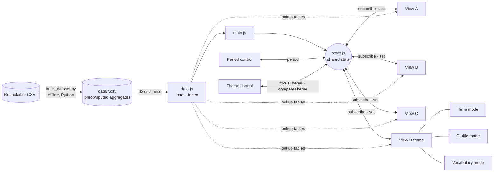

# Architecture

How data moves through the prototype (for the report and the video).

- **Precompute offline, add up online.** Medians, quartiles, shares, ranks, log-sums and parts per part category are computed once in Python, per theme and year. When the period changes, a view only adds the rows of the selected years for the themes it shows.
- **One shared state, no direct links between views.** A view publishes a change (`store.set`) and every subscribed view redraws if a key it uses changed. Several changes in the same frame produce one redraw.
- **Why adding a view is easy.** A new view is one file exporting `createView(el, store, data)`, one `<section>` in `index.html` and one line in `main.js`. It immediately receives the period and the themes, and anything it publishes reaches all other views without changing them. View D (CP4) was added this way without changing A, B or C.
- **View D: a frame plus one file per mode (CP4).** `viewD.js` draws what every mode shares (tabs, rows, headers, outlines, legend, tooltip, clicks). Each mode (`viewD-time.js`, `viewD-profile.js`, `viewD-vocabulary.js`) is an object that only returns its columns, its cells (value, colour, tooltip) and its legend. A new mode is one more file and one line in the frame's list.
- **Fixed-size page (CP4).** `stage.js` lays the dashboard out once at 1920 × 1080 and scales it as one picture to fit the window, so it looks the same on every screen.
